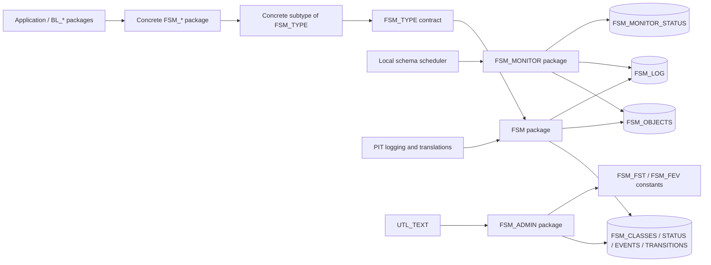
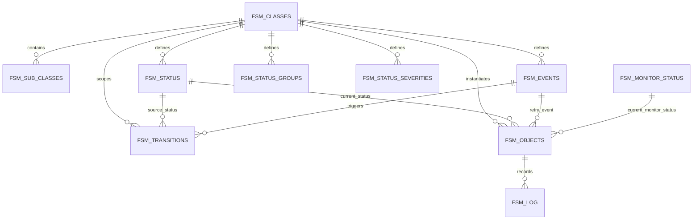

# Architecture map

## System shape

FSM is a reusable Oracle utility schema. Legal workflows are metadata; generic execution is PL/SQL; concrete applications supply a SQL subtype and domain packages.

## Components and source of truth

| Area | Responsibility | Primary source |
|---|---|---|
| Runtime contract | Common state-machine attributes and overridable lifecycle hooks | `FSM/core/types/fsm_type.tps`, `fsm_type.tpb` |
| Runtime engine | Initialization, event validation, transitions, persistence, retry, logging, escalation, finalization | `FSM/core/packages/fsm.pks`, `fsm.pkb` |
| Administration | Metadata CRUD and validation, export, diagrams, constant-package generation | `FSM/core/packages/fsm_admin.pks`, `fsm_admin.pkb` |
| Metadata model | Classes, subclasses, statuses, groups, severities, events, transitions | `FSM/core/tables/*.tbl` |
| Runtime state | Current object state and retry information | `FSM/core/tables/fsm_objects.tbl` |
| Audit trail | Status/event history and notifications | `FSM/core/tables/fsm_log.tbl` |
| Monitoring | Generic persisted class scan, metadata-driven scan of all configured classes, monitor signals, and current monitor projection | `FSM/core/packages/fsm_monitor.pks`, `fsm_monitor.pkb` |
| Monitor metadata | Global translated states and severity order | `FSM/core/tables/fsm_monitor_status.tbl` |
| Read models | Enriched metadata, state, valid commands, and graph edges | `FSM/core/views/*.vw` |
| Installation | Schema setup, initial data, generated objects, grants; optional local scheduler scripts are excluded from standard installation | `FSM/core/install.sql`, `FSM/install_scripts/`, `FSM/core/scripts/` |
| Installation identity | Git-derived product version and commit substituted directly into FSM getter methods | `VERSION`, `FSM/tools/version.sh`, `version.ps1`, `FSM/core/packages/fsm.pks`, `fsm.pkb` |

## Metadata relationships

`FSM_TRANSITIONS` is the central join between a class/subclass, a source status, and an event. Its target status information determines the legal graph. `FSM_OBJECTS` is the mutable runtime projection; `FSM_LOG` is its history.

## Architectural invariants

- `FSM_TYPE` is a contract and delegation boundary, not the main home of business logic.
- The `FSM` package owns generic transition mechanics; concrete `FSM_*` packages orchestrate domain behavior; `BL_*` packages make business decisions.
- Metadata defines which transitions are legal. Implementations should use generated `FSM_FST` and `FSM_FEV` constants rather than literal identifiers.
- Concrete class visibility follows Oracle type visibility and `EXECUTE` grants.
- Installation order matters: subtype, class registration, metadata, generated constants, then concrete handlers/business logic.
- PIT is an external dependency for logging/assertions and translations; UTL_TEXT is required by `FSM_ADMIN` for generation.
- Monitoring is centrally defined but locally invoked. `FSM_MONITOR` never calls consuming schemas and never instantiates concrete FSM types.
- Scheduler jobs are optional objects of consuming schemas. The scripts in `FSM/install_scripts/optional/` are not called by standard installation and create monitor jobs disabled so that activation remains an explicit local decision.

## Installation identity flow

`fsm.sh install` runs `tools/version.sh resolve` with Bash 3.2+;
`fsm.bat install` runs `tools/version.ps1 resolve` with PowerShell 5.1+ before
credentials/SQL*Plus. No Python dependency exists in installation or export.
A clean full Git checkout
supplies `VERSION` (major/minor), all reachable commit count and full hash from a
single captured commit. No path filtering or count reset is applied. Stale
release metadata never overrides the checkout. Outside Git, prepared
`install_scripts/release-version.txt` supplies the same pair. Each helper's
`export` command creates a committed-source ZIP and adds that metadata only to
the archive; it does not rewrite source files. Unix export uses Git and the
standard `zip` utility; Windows uses Git and .NET ZIP support. Offline installation
needs neither Git nor an archive utility.

Starters run SQL*Plus from `FSM/` and pass owner, language, version and commit.
The Windows runner forwards arguments 5--8 explicitly (SHIFT does not alter
`%*`). `install_scripts/install.sql` captures arguments 3/4 into named variables
before nested scripts overwrite positional parameters and validates their format
before DDL. `core/install.sql` also validates these variables for direct callers.
SQL*Plus substitutes the values inside the existing FSM body. No extra database
object, grant, synonym, runtime data or PIT message is needed. Final
`tools/verify_version.sql` requires a valid FSM specification/body and compares
SQL getter results to the installation inputs before reporting success.

The public functions `fsm.get_version` and `fsm.get_git_commit` return the
installed product identity without logging or transaction changes. FSM's normal
PIT AUTO_COMMIT initialization still applies, but the getters do not access the
SERIALLY_REUSABLE event context. Direct source reinstalls require the named
variables; recompiling stored source does not. DDL is not atomic, and this
identity is not an integrity check for later manual database/ZIP edits.

## Technical client read layer

All ten core tables additionally expose unfiltered, language-neutral 1:1 `_tv`
views. Client READ grants with grant option and same-name private synonyms are
managed by the existing core lifecycle scripts. Runtime and enriched `_v`
contracts remain unchanged. Inventory, keys, installation paths, validation and
the external PIT message-severity prerequisite are recorded in
[technical-view-layer.md](technical-view-layer.md).

## Event transaction ownership

The FSM runtime owns conditional event admission, row locking, refresh and a
nested event context. SET_STATUS is a context-guarded public target assignment;
SET_STATUS internally pops its frame. Owner-only FSM_EVENT_CONTEXT is
SERIALLY_REUSABLE and stores events/reasons for one server call, while normal FSM
keeps transaction policy and runtime logic. PIT's FSM.AUTO_COMMIT parameter
is cached per package initialization. Retry/error state changes share the main
transaction; technical diagnostics use PIT's autonomous output. LOCK_FSM has been
removed. See [transaction-boundary.md](transaction-boundary.md) for migration and
explicit remaining monitor/application boundaries.
