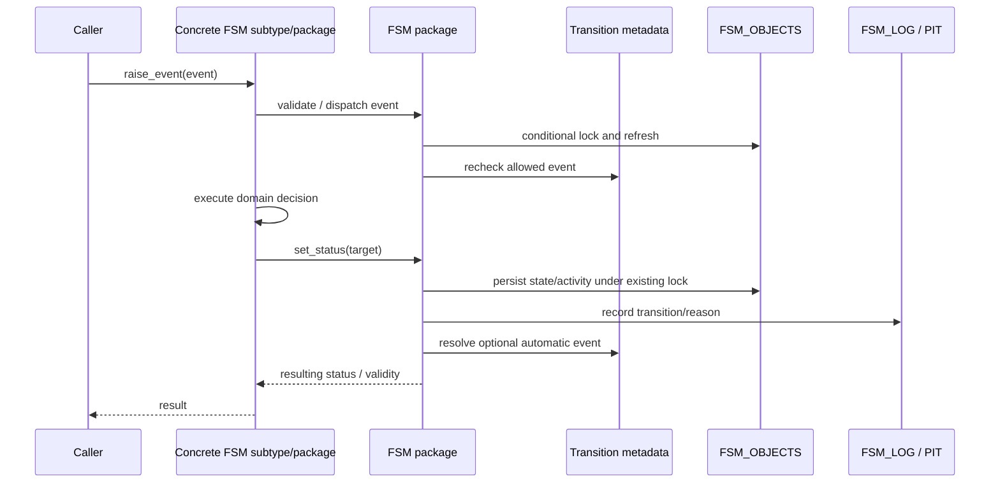

# Runtime flow map

## Normal event path

The detailed implementation lives primarily in `FSM/core/packages/fsm.pkb`; the overridable contract and hooks are in `FSM/core/types/fsm_type.tps`.

## Event and transaction lifecycle

RAISE_EVENT now locks conditionally, reloads common/subtype state and validates
before the concrete handler calculates its target. Public SET_STATUS requires
that event context and internally pops it at successful completion. The internal
SERIALLY_REUSABLE FSM_EVENT_CONTEXT stores frames/reasons only for the server
call; it is not exposed to concrete handlers. Automatic nested events do not
commit independently. PIT parameter FSM.AUTO_COMMIT is read
once at package initialization; only successful completion with an empty event stack may commit.
FALSE leaves all state, retry and history changes to the caller transaction.
Technical errors are reported to PIT's autonomous output and propagate without
conversion to FSM_ERROR. Business retries/error routes remain modeled state
changes. No savepoints or public LOCK_FSM remain.

See [transaction-boundary.md](transaction-boundary.md) for protocol, deployment,
monitor boundary and validation.

## Escalation time model

- `FSM_LAST_CHANGE_DATE` represents relevant activity/event time.
- `FSM_STATUS_CHANGE_DATE` changes only when the status changes.
- A status with escalation basis `EVENT` measures silence; basis `STATUS` measures time spent in the status.
- An optional local job calls `FSM_MONITOR.SCAN_ALL`. The method selects classes with configured warning or alert intervals from `FSM_STATUS` and scans their persisted instances without constructing concrete FSM types. The supplied creation script is outside the standard installation and leaves the job disabled until the consuming schema explicitly enables it.
- The scan compares the calculated state with the persisted monitor state in `FSM_OBJECTS`.
- Each newly crossed upward state is returned and logged; a downward movement returns and logs the new current state, including `OK`.
- `FSM_OBJECTS_V.STATUS_STATE` exposes the last monitor state persisted by a scan.
- The scan operates in an autonomous transaction, so later local signal handling cannot roll back the detected state or its log entry.
